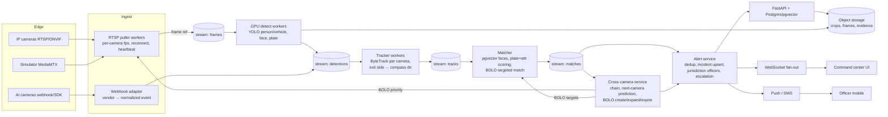

# Aegis → National Surveillance & Incident Response — Findings & Plan

Status: implemented (all steps A–P), 2026-11-23. How it works and how to run it: `docs/NATIONAL_SYSTEM.md`.
Migrations ended up as 0014–0020 (0011–0013 were taken by two-factor sign-in, push and floor plans).

## 1. Findings (current codebase)

| Area | Current |
|---|---|
| Frontend | React 19 + Vite 8, plain JSX, no router (page state in `App.jsx`), lazy pages |
| UI library | none — in-house primitives `frontend/src/components/ui.jsx` (Icons, Card, Pill, Seg, Empty, Modal), `Toast.jsx` |
| Styling | one global `frontend/src/index.css` (1.8k lines), CSS custom-property tokens, dark/light themes, Geist/Oswald fonts (no Bangla font) |
| Maps | Leaflet 1.9 (`OpsMap.jsx`, `MapPage.jsx`) |
| Backend | FastAPI (`backend/main.py`, 25 routers under `backend/api/`) |
| DB/ORM | SQLAlchemy + Alembic (0001–0010), PostgreSQL prod / SQLite fallback; `pgvector` in requirements but unused |
| Realtime | WebSocket `/ws/alerts`, `/ws/status`; Redis optional (HA only, `backend/services/ha.py`) — no queue between stages |
| CV pipeline | `main.py` → `SurveillancePipeline` (detect→track→recognize→behavior→analytics→output), YOLO (ultralytics), YuNet + dlib face workers, ST-GCN action, EasyOCR ANPR, person re-ID cross-camera tracker (in-process) |
| Auth | JWT + token_version, roles `admin, supervisor, operator, police, investigator, viewer`; guards in `backend/auth/` |
| Tests | pytest (unit + integration, 70% gate), Vitest `src/lib`, Playwright smoke |

### Domain models today
- **Camera** (`backend/models/camera.py`): camera_id, name, location text, lat/lng, rtsp_url, heading, fov, range_m, active, geometry. Live config also in `config/cameras.yaml`. No protocol, credentials, admin areas, capabilities, health status.
- **Incident**: ticket_id, type, priority, status ∈ {open, investigating, resolved, closed} (no transition rules), single `assigned_to` user, `IncidentNote`, `IncidentEvent` (timeline already exists, free-form).
- **Officer**: just `User(role="police")` + `phone`; `CameraOfficer` maps camera→officers (priority). No rank, badge, thana, duty status, jurisdiction geometry.
- **Criminal**: `KnownPerson` (category, criminal_status, threat_level) + `PersonImage` + `FaceEncoding` (dlib 128-d, LargeBinary). No case/FIR, approval, expiry.
- **Vehicle**: `LicensePlate` (plate, watchlisted, reason) + `VehicleDetection` (type, plate). Plate normalization strips to one string (Bangla letters kept, digits → ASCII) — no canonical district/class form, no attributes.
- **Evidence**: `Evidence` (frame/roi, encrypted blobs, sha256) + hash-chained `CustodyLog`. Tied to detection tracks, not to incidents; no officer upload, versions, or face grouping.
- **Alert**: type, severity, ack, escalation, review_status (confirm/reject exists). **AuditLog**: plain table, not append-only.

### Gaps vs. spec (biggest first)
1. No message bus / horizontally scalable workers — pipeline is one process per box.
2. No jurisdiction model, officer profile, or geo eligibility.
3. No vehicle attributes, re-ID, BOLO, camera graph, compass direction.
4. Watchlist governance (case no., 2-person approval, expiry) absent.
5. Evidence face grouping, dataset/model registry, review queue absent.
6. No i18n, no Bangla font, no Settings sections.

## 2. Key technical decisions

| Decision | Choice | Why |
|---|---|---|
| Message bus | **Redis Streams** (consumer groups) | Redis already in stack/HA; enough for thousands of cameras at metadata rates; frames stay in object storage / shared memory, only refs on the bus. Kafka later if >50k evt/s. |
| Vector index | **pgvector** (HNSW) | Already a dependency; one DB; FAISS in-process cache for hot watchlist. SQLite fallback = numpy brute force. |
| Face embeddings | ArcFace (InsightFace `buffalo_l` ONNX, 512-d) alongside existing dlib; `encoding_version` column already exists for migration | |
| Geo | GeoJSON polygons in Text/JSON column + shapely point-in-polygon; PostGIS optional later | Works on SQLite dev |
| Router | keep current page-state nav (no react-router) | avoid breaking existing deep links/tests |
| i18n | tiny in-house `t()` + `locales/{en,bn}.json`, Noto Sans Bengali / Hind Siliguri font | no new heavy deps |
| Object storage | local `evidence/` now, S3-compatible (MinIO) adapter interface | |

## 3. Phased plan (reordered for dependencies)

Spec phase numbers kept; delivery order:

| Step | Phase(s) | Deliverable | Size |
|---|---|---|---|
| A | 1 | Design tokens, Badge/StatusBadge/Skeleton/EmptyState/ErrorState, toast on every action, i18n scaffold + Bangla font, Settings shell (side-nav, sticky save bar, unsaved warning), Respond/Incidents/Settings restyle | L |
| B | 15 (core) + 14 roles | Migrations 0011–0014: jurisdictions, officer profiles, incident status v2, timeline typing, roles ⊕ ml_engineer, auditor; append-only audit | M |
| C | 3 | Status state machine (shared JSON spec used by FE + BE), StatusSelector, confirm+note dialogs | S |
| D | 2 | Incidents list (filters/sort/server paging), detail drawer, typed timeline, WS live updates | M |
| E | 4 | Eligible-officers endpoint (polygon ∋ camera, availability, distance), picker modal, multi-assign, neighbor override (supervisor+, audited), officer admin | M |
| F | 6 | Watchlist governance for persons + vehicles, 2-person approval, expiry job, view audit | M |
| G | 5 | Camera registry v2, encrypted credentials, CSV import, map heading editor; adapter layer (RTSP puller, webhook normalizer), Redis Streams bus, worker split, health dashboard | XL |
| H | 8 | ArcFace + pgvector matching, quality gate, two thresholds, verify UI, non-watchlist embedding discard | L |
| I | 7.1–7.3, 7.5 | Bangla plate parser/canonicalizer, fuzzy plate (OCR confusion), vehicle attributes, scoring engine, alert comparison card | L |
| J | 9 | Within-camera trajectory → compass direction, camera graph, next-camera prediction, BOLO lifecycle, re-acquisition into same incident, jurisdiction notifications | XL |
| K | 10 | Ack timers, escalation chain, dedup, push/SMS adapters, officer mobile card | M |
| L | 11 | Command-center map: trails, BOLO cameras, predicted path, admin filters | M |
| M | 12, 13 | Officer evidence upload (chunked, hashed, versioned), face grouping service, merge/split/move | L |
| N | 7.4, 7.6 | Dataset module, training scripts (Ultralytics, timm, re-ID), model registry promote/rollback, review queue, Vehicle Search page | XL |
| O | 14 rest | MFA (TOTP), IP allowlist, session timeout, retention jobs for detections, accuracy dashboard | M |
| P | 16 | Camera simulator (MediaMTX serving local MP4 as RTSP, 8 Dhaka cameras), seed data, load-test plan (Locust + synthetic event generator) | M |

Tests are written inside each step, not deferred to P.

### Honest limits
- **Model accuracy needs data.** I can ship training code, configs, registry and a pretrained baseline (COCO vehicles, VeRi-pretrained re-ID if weights are licensed for your use). Bangla-plate OCR, BD vehicle classes (CNG, leguna, easy-bike) and make/model need your labeled footage; until then those heads will be weak and must stay behind operator verification.
- Bangla plate OCR: EasyOCR `bn` is the baseline; a dedicated plate recognizer (YOLO char-detector or CRNN) trained on BD plates is in step N.
- Dev box (8 GB M2) can't run the full multi-worker stack at once; simulator demo will run 3–4 cameras locally, more in Docker on a GPU host.
- Thousands of cameras = deployment/infra work (GPU nodes, MediaMTX/RTSP relays, Redis cluster) beyond code; I'll provide compose/k8s-ready services and the load-test plan, not a production rollout.

### Safeguards (kept non-optional in code, not config)
Human verification before any field action; watchlist entries require legal basis + approver ≠ requester + expiry; non-watchlist face embeddings never persisted; append-only audit for searches/views/overrides; jurisdiction filtering server-side. These are enforced in services so a config flag can't disable them.

## 4. Schema changes (migrations 0011+)

Existing tables are extended, not replaced. `Criminal` = existing `known_persons`.

```text
0011_jurisdictions_officers
  jurisdictions(id, code UQ, name_en, name_bn, level[division|district|thana|beat],
                parent_id→jurisdictions, geojson TEXT, created_at)
  officer_profiles(user_id PK→users, rank, badge_no UQ, thana_id→jurisdictions,
                   photo_path, duty_status[available|on_duty|busy|off_duty],
                   last_lat, last_lng, last_seen_at)
  officer_jurisdictions(user_id→users, jurisdiction_id→jurisdictions, PK both)
  users.role ⊕ 'ml_engineer','auditor'; users ⊕ mfa_secret_enc, mfa_enabled

0012_cameras_v2
  cameras ⊕ protocol[rtsp|onvif|vendor|webhook], vendor, credentials_enc BLOB,
            address, division_id, district_id, thana_id, jurisdiction_id→jurisdictions,
            road_name, capabilities JSON[face,anpr,vehicle_attr,ptz], ir_mode,
            status[online|offline|degraded], last_heartbeat, sample_fps, priority
  camera_edges(id, from_camera, to_camera, distance_m, travel_s_typ, bearing_deg,
               bidirectional, auto_suggested, UQ(from,to))

0013_incidents_v2
  incidents.status remap: open→new, investigating→in_progress, resolved, closed
               (+ acknowledged, verified_match, officer_dispatched, target_located,
                false_alarm)
  incidents ⊕ severity, source[face_match|vehicle_match|manual], area_id,
              watchlist_person_id, watchlist_vehicle_id, cross_track_id, snapshot_evidence_id
  incident_assignments(incident_id, user_id, assigned_by, assigned_at, role, state
                       [assigned|ack|en_route|located|unable], PK(incident,user))
  incident_events ⊕ actor_id, kind (typed enum), payload JSON, camera_id
  audit_logs: ⊕ prev_hash, record_hash (hash chain); DB trigger/ORM guard blocks UPDATE/DELETE

0014_watchlists
  known_persons ⊕ aliases JSON, case_no, offence, risk_level, issuing_authority,
                  legal_basis, requested_by, approved_by, approved_at,
                  wl_status[pending|active|expired|revoked], starts_at, expires_at
  watchlist_vehicles(id, plate_raw, plate_canonical idx, vehicle_type, color_primary,
                     color_secondary, make_model_id, marks, notes, linked_person_id,
                     + same governance cols, CHECK plate OR (type AND color))
  watchlist_vehicle_photos(id, vehicle_id, path, sha256)
  vehicle_classes / vehicle_colors / vehicle_make_models (managed lists, name_en, name_bn, active)
  (license_plates migrated into watchlist_vehicles; table kept as view for compat)

0015_detections_tracking
  detections(id, camera_id, ts idx, kind[face|vehicle], track_id, bbox JSON,
             crop_ref, frame_ref, plate_raw, plate_canonical idx, plate_conf,
             vehicle_type, color, make_model, attr_conf JSON, color_reliable,
             direction, expires_at idx)        -- retention-purged
  embeddings(id, owner_kind[watch_person|watch_vehicle|detection|evidence_face|group],
             owner_id, model_version, vec VECTOR(512) / BLOB)  -- HNSW index on PG
  tracks(id, camera_id, local_track_id, kind, started_at, ended_at,
         entry_side, exit_side, direction_8, points JSON)
  cross_camera_tracks(id, incident_id, target_kind, target_ref, status[active|lost|closed],
                      last_camera_id, last_seen_at, direction)
  cross_track_hops(id, cross_track_id, track_id, camera_id, seen_at, confidence, method)
  bolos(id, cross_track_id, target_payload JSON, origin_camera, direction,
        window_start, window_end, ring, status[active|reacquired|expired|cancelled])
  bolo_cameras(bolo_id, camera_id, rank, eta_s)
  alerts ⊕ incident_id, score, match_breakdown JSON, dedup_key idx, ack_deadline

0016_evidence_groups_ml
  evidence ⊕ incident_id, kind[image|video|audio|pdf|snapshot], description,
             captured_at, location, original_filename, size, device_info,
             version, parent_id, deleted_at, deleted_by, delete_reason, uploader_id
  person_groups(id, code 'UNKNOWN-000123', name, known_person_id, status,
                best_face_id, first_seen, last_seen)
  evidence_faces(id, evidence_id, frame_ts, bbox, embedding_id, group_id,
                 watch_match_person_id, match_score, verify_status)
  group_ops_log(...)  -- merge/split/move
  datasets(id, name, version, task, split_json, created_by, frozen)
  dataset_items(id, dataset_id, path, sha256, split, day_night, source)
  dataset_labels(item_id, field, value, labeler_id)
  model_versions(id, task, name, version, metrics JSON, dataset_id, artifact_path,
                 format[pt|onnx|trt], stage[staging|production|archived], promoted_by/at)
  review_queue(id, detection_id, crop_ref, field, predicted, corrected, reason,
               created_by, consumed_dataset_id)
  notifications(id, user_id, alert_id, incident_id, channel, status, sent_at, ack_at)
```

Seeds: Dhaka divisions/districts/~10 thanas (simplified polygons), 8 sim cameras + edges, 12 officers with photos, 5 persons, 6 vehicles with Bangla plates, class/color/make lists.

## 5. Real-time architecture



Streams are Redis consumer groups keyed by camera shard; any stage scales by adding consumers. In dev, `main.py` keeps running everything in-process via the same stage interfaces (no Redis required), so the current demo keeps working.

## 6. Open decisions for you
1. Delivery order above OK (UI first), or start with the backend core (B–E)?
2. Commit the current uncommitted work (0009/0010, backup, maintenance) first so each phase is a clean diff?
3. Real jurisdiction boundaries: do you have thana GeoJSON (BBS/LGED shapefiles), or should I seed simplified polygons?
