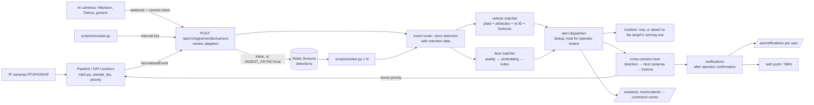

# Aegis national surveillance & incident response — system guide

What was added on top of the single-site Aegis: nationwide camera registry and ingestion, watchlists
with legal governance, vehicle and face matching, multi-camera tracking with lookouts, jurisdiction-based
officer dispatch and notifications, case evidence with chain of custody and face folders, a training
pipeline with a model registry, and a city simulator. Plan and schema: `docs/NATIONAL_ROADMAP.md`.

## Real-time pipeline



## What each phase delivered (where to look)

| Phase | Backend | Dashboard |
|---|---|---|
| 1 UI/UX | — | `components/ds.jsx`, `styles/10-design.css`, `lib/i18n.js` (EN / বাংলা) |
| 2–3 Incidents, status | `api/incident_routes.py`, `services/incident_status.py` | Incidents page, `StatusSelector`, `IncidentDrawer` |
| 4 Officers by jurisdiction | `services/jurisdiction.py`, `api/jurisdiction_routes.py` | Officer picker, Settings → Jurisdictions / Users & roles |
| 5 Cameras & ingestion | `api/camera_registry_routes.py`, `api/ingest_routes.py`, `core/ingest/`, `core/bus/` | Cameras → Health / Registry / Import CSV |
| 6 Watchlist governance | `services/watchlist_gov.py`, `api/watchlist_routes.py`, `core/analysis/bd_plate.py` | Settings → Watchlists |
| 7 Vehicles | `core/analysis/vehicle_match.py`, `vehicle_attrs.py`, `services/matching/vehicle.py`, `api/detection_routes.py` | Match card, Vehicle search, Settings → Vehicle classes |
| 7.4 Training | `services/ml.py`, `api/ml_routes.py`, `training/` | Models & data |
| 8 Faces | `core/recognition/embedder.py`, `quality.py`, `services/face_index.py`, `services/matching/face.py` | Face match card, thresholds |
| 9 Tracking & lookouts | `core/tracking/direction.py`, `services/tracking.py`, `api/lookout_routes.py`, `api/tracking_routes.py` | Command map |
| 10 Alerting | `services/notify.py`, `services/escalation.py` | Responders → notifications |
| 11 Command map | `GET /map/command` | Command map |
| 12–13 Evidence | `services/case_evidence.py`, `services/face_grouping.py`, `api/case_evidence_routes.py` | Evidence → Upload / Case evidence / People in evidence |
| 14 Governance | `auth/policy.py`, `services/audit.py` (hash chain), `api/governance_routes.py` | Settings → Data retention, Analytics → Accuracy |
| 16 Simulation | `scripts/simulate.py`, `scripts/loadtest/`, `docs/LOAD_TEST.md` | — |

## Setup

```sh
./scripts/setup.sh                       # venv, deps, models (YuNet, SFace, re-ID, action)
alembic upgrade head                     # Postgres; SQLite dev DBs are migrated on start-up
python scripts/seed_jurisdictions.py --officers   # simplified Dhaka thanas + 28 demo officers
./run.sh --no-pipeline                   # API + dashboard
```

Real thana boundaries: replace the simplified rectangles with official BBS / LGED polygons
(Settings → Jurisdictions, or `PUT /api/v1/jurisdictions/{id}`).

## Environment variables (new)

| Variable | Default | Meaning |
|---|---|---|
| `MFA_REQUIRED` | false | Every account must turn on two-step sign-in before anything else works |
| `ADMIN_IP_ALLOWLIST` | (any) | CIDRs admin accounts may connect from |
| `VITE_IDLE_MINUTES` | 30 | Dashboard idle sign-out (build time; 0 = off) |
| `WATCHLIST_MAX_DAYS` | 365 | Longest validity of a watchlist entry before renewal |
| `DETECTION_RETENTION_DAYS` | 30 | Non-matched detections / plate reads (Settings overrides) |
| `INGEST_ASYNC`, `BUS_URL` | off, — | Queue events on Redis Streams for `scripts/worker.py` |
| `INGEST_RATE_LIMIT` | 6000/min/IP | Camera-gateway webhook budget |
| `TRACK_CONE_DEG`, `TRACK_MAX_RING`, `TRACK_SPEED_KMH`, `TRACK_MAX_SPEED_KMH`, `TRACK_IDLE_MINUTES`, `TRACK_NEIGHBOUR_KM` | 60, 2, 25, 140, 120, 3 | Next-camera prediction and lookouts |
| `TRACK_SWEEP_SECONDS` | 15 | Lookout expand / lost + notification escalation |
| `ACK_SECONDS_CRITICAL` / `_HIGH` / `_MEDIUM` | 60 / 120 / 300 | Officer acknowledgement deadline before escalation |
| `GROUP_SIMILARITY`, `GROUP_VIDEO_EVERY_S` | 0.5, 2 | Evidence face folders |
| `FACE_MIN_PX`, `FACE_MIN_SHARPNESS`, `FACE_MAX_YAW` | 40, 45, 40 | Face quality gate |
| `EVIDENCE_MAX_MB` | 100 | Upload size limit |
| `AEGIS_CAMERAS_YAML`, `AEGIS_UPLOADS_DIR`, `AEGIS_DATASETS_DIR`, `AEGIS_MODEL_STORE`, `AEGIS_MODELS_DIR` | repo paths | Move files elsewhere (tests and the e2e server use temp dirs) |
| `LOGIN_RATE_LIMIT`, `WRITE_RATE_LIMIT` | 10, 240 /min/IP | Request limits |

Thresholds editable in Settings: face alert / possible similarity, vehicle matching weights, night
colour weight, re-ID threshold.

## Roles

Super admin (`admin`), command-centre operator (`operator`), supervisor, field officer (`police`),
investigator, ML engineer (`ml_engineer`: datasets / models only), auditor (`auditor`: audit log,
accuracy), wall display (`viewer`). Police see only incidents and evidence of their areas or
assigned to them; every rule is checked by the API.

## Safeguards built in (not switchable)

* Watchlist entries need case / FIR / GD number, legal basis, issuing authority, a second person's
  approval and an expiry; only approved, unexpired entries alert (checked at match time).
* Identification alerts are "possible match — needs verification"; nothing leaves the command centre
  and officers are not dispatched by the tracker until an operator confirms.
* Faces of people not on a watchlist leave no trace (no crop, no embedding, no row).
* Plate-less "candidate vehicle" alerts only inside an active lookout.
* Audit log and evidence custody are hash-chained and append-only (`GET /api/v1/audit/verify`).

## Train and promote models

See `training/README.md`. In short: build a dataset in *Models & data* (or from the review queue),
split, freeze, export, `python -m training.train_attributes --data …`, `python -m training.register …`,
then *Promote* in the registry (rollback available). Until trained models exist, baselines run.

## End-to-end demo with the simulator

```sh
./run.sh --no-pipeline                        # terminal 1
python scripts/simulate.py seed               # once
python scripts/simulate.py run --speed 20     # terminal 2
```

Sign in as `sim_operator` (password `sim-pass-2026`, or `SIM_PASSWORD`): Alerts shows the
"Confirmed vehicle match"; confirm it. Command map shows the trail, lookout rings and predicted path;
sign in as an officer of Gulshan / Banani (e.g. `officer_gulshan_1`, password `sim-officer-2026`) on a
phone-sized window → Responders shows "detected at …, moving N … ETA". `--auto-confirm` does the
confirmation itself. For RTSP: `python scripts/simulate.py rtsp` with MediaMTX and clips in
`data/demo/clips/`.

## Tests

```sh
pytest tests/                          # 490+ tests, isolated temp DB / files
cd frontend && npm test && PW_CHANNEL=chrome npm run e2e     # unit + 16 browser flows
```

## Known limits

* Vehicle type / colour / make-model and re-ID run on baselines until trained on Bangladeshi footage.
* Bangla plate OCR uses EasyOCR; the parser handles Bangla and English text, but OCR quality on
  real plates needs a dedicated recogniser (train with the detector pipeline on plate crops).
* PTZ follow-the-target is not implemented (ONVIF PTZ is available per camera via `/vms`).
* Officer GPS comes from the phone (`PUT /officers/me/duty` with position); no MDM integration.
* Scale beyond one machine needs the queued mode, Postgres + pgvector, object storage and the load
  tests in `docs/LOAD_TEST.md`.
